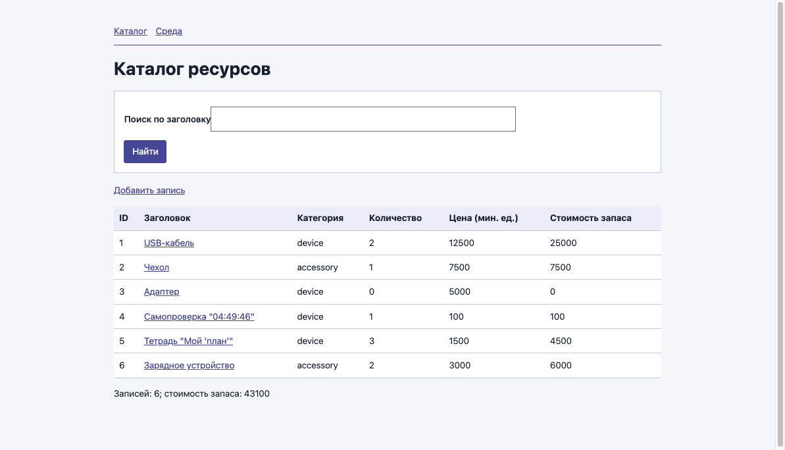
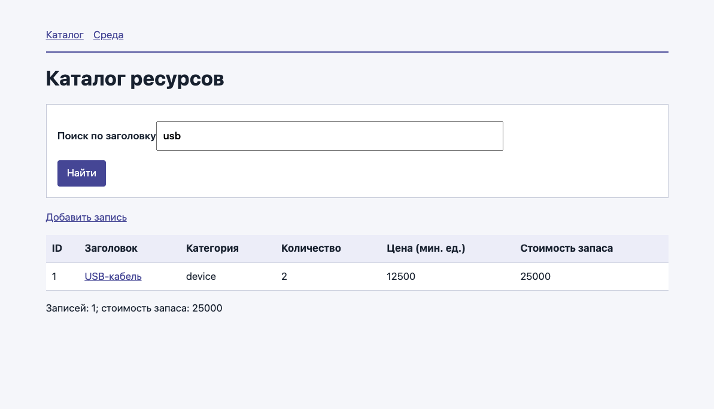
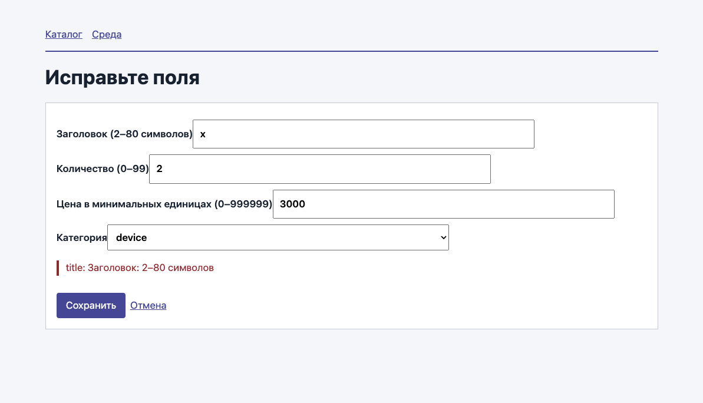
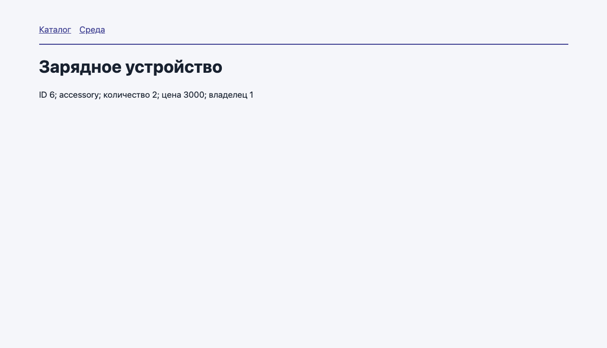
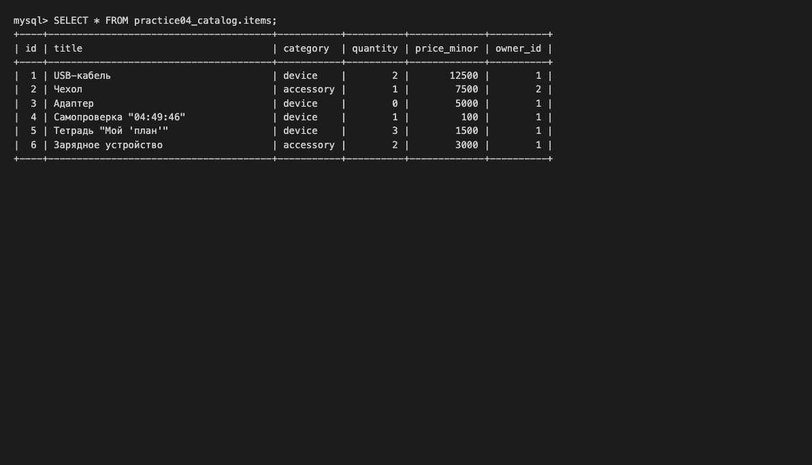
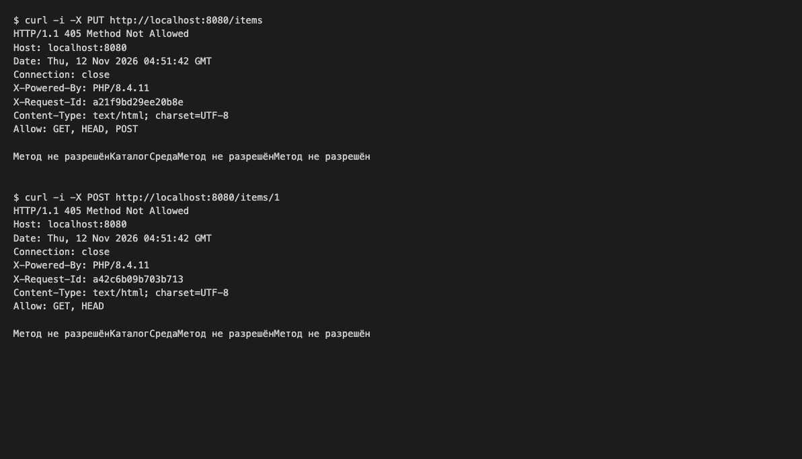

# Практическая работа № 4: маршруты, контроллер и MySQL

**Студент:** группа CS-302(С)
**Вариант:** A (техника)

## Среда

| Компонент | Версия или путь |
|---|---|
| Веб-сервер | встроенный сервер PHP (`php -S localhost:8080 -t public router.php`) |
| PHP (из `/health.php`) | 8.4.11, SAPI `cli-server`, `pdo_mysql: true` |
| PHP CLI (`php -v`) | 8.4.11 |
| Composer (`composer --version`) | 2.8.1 |
| Сервер БД (`SELECT VERSION();`) | MySQL 9.4.0 |
| Папка проекта | `practice_04` |
| Веб-корень | `practice_04/public` |

## Запуск

1. Импорт: `sql/schema.sql`, затем `sql/variant_A.sql` (`mysql --default-character-set=utf8mb4`).
2. `config.local.php` создан из `config.example.php` (пароль в README не указывается).
3. `composer install`
4. `php -S localhost:8080 -t public router.php`
5. `php bin/self-check.php`

Для Uniform Server: подключить `apache-course.conf` с полным путём к `practice_04/public`, импортировать SQL через phpMyAdmin, адрес — http://localhost:8080/.

## Выполненные этапы

| Этап | Файл | Реализация |
|---|---|---|
| `P04-CONNECTION` | `src/Infrastructure/Database.php` | `new PDO($dsn, $user, $password, [...])` с `ERRMODE_EXCEPTION`, `FETCH_ASSOC`, `EMULATE_PREPARES => false` |
| `P04-COMPOSITION` | `bootstrap.php` | `ItemController` получает репозиторий и категории варианта через конструктор; пять маршрутов: GET `/`, GET `/items`, GET `/items/new`, GET `/items/{id}`, POST `/items` |
| `P04-ROUTING` | `src/Http/Router.php` | шаблон пути проверяется целиком (`^…$`), `{id}` — `[1-9][0-9]{0,8}`; HEAD выбирает GET-обработчик без изменения `Request`; найденный путь с чужим методом — 405 и `Allow` без повторов, иначе 404 |
| `P04-RESPONSE` | `src/Http/Application.php`, `src/Http/Response.php` | `X-Request-Id` добавляется после `try/catch` ко всем ответам; `send()` отправляет статус и заголовки, тело — только если метод не HEAD и статус не 204 |
| `P04-SQL` | `src/Repository/PdoItemRepository.php` | `find()` — `WHERE id = :id`; `matching()` — `LIKE :pattern` с `addcslashes($query, '%_\\')`; `create()` — `INSERT` с именованными параметрами и `lastInsertId()` |

## Снимки экрана

**Каталог своего варианта** (`/items`, три исходные записи и добавленные):

**Поиск** (`/items?q=usb`):

**Ошибка формы** (заголовок из одного символа, ответ 422 с сообщением):

**Созданная запись** (страница `/items/6` после сохранения формы):

**Таблица `items`** с той же записью (клиент `mysql`):

**`curl -i`:** ответ 405 с заголовком `Allow` и `X-Request-Id`:

## Самопроверка

Результат `php bin/self-check.php`: [self-check-result.md](self-check-result.md). Пройдено 23 из 23.

Дополнительно проверено:

| Запрос | Результат |
|---|---|
| GET `/items/1/edit` | 404 |
| GET `/items?q=_` | 200, «Записей: 0» |
| GET `/items?q=USB` | 200, одна запись (поиск без учёта регистра) |
| Неверный пароль в конфигурации | 503 «База данных недоступна», без DSN и пароля в ответе |
| Запись `Тетрадь "Мой 'план'"` через форму | 303 → `/items/5`, заголовок сохранён и выводится без искажений |
| HEAD `/items` | 200, заголовки с `X-Request-Id`, тело отсутствует |

## Что было трудным

Маршрутизатор сначала нужно было научить отличать 405 от 404: если вернуть ошибку после первого несовпавшего маршрута, PUT `/items` превращается в 404, хотя у пути есть GET и POST. Поэтому `dispatch()` перебирает все маршруты, собирает методы совпавших путей и только в конце решает, какой статус вернуть.
